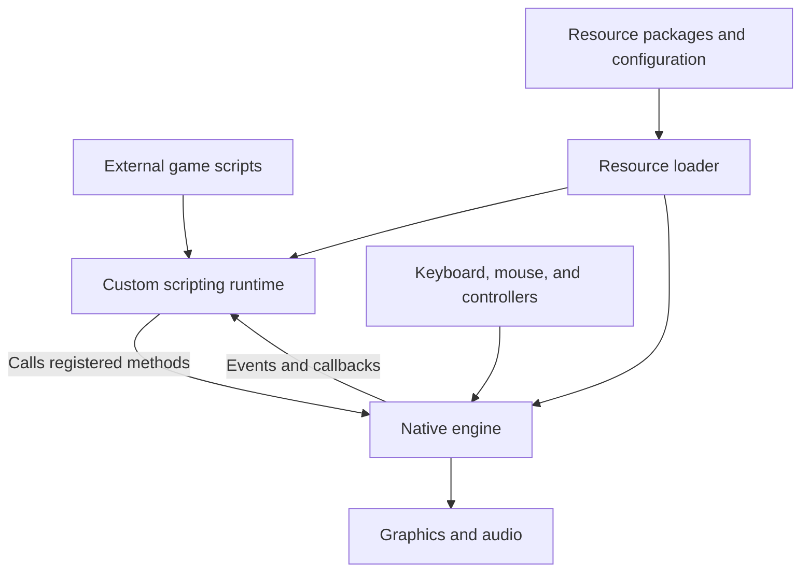

## What this file is

**`all_pseudo.c` is a large decompiled view of the native executable for Street Legal / SL2, consistent with Street Legal Racing: Redline v2.2.1, build 606.** It contains recovered code for the game’s engine: vehicle simulation, its scripting system, graphics, input, audio, resource loading, and supporting utilities.

The important distinction is that **this is a tool’s reconstruction of compiled code**. Much of the original organization, naming, and type information is missing, which is why it looks so cryptic. It is still useful: recognizable strings, Windows function calls, mathematical operations, and connections between functions reveal a substantial amount about how the game works. all_pseudo

I inspected the file’s overall structure, startup path, scripting interfaces, and representative functions across its major systems. Here is how to understand it.

---

## 1. What identifies the game and version

The clearest identification is inside `FUN_0058c700`, the main startup routine. It passes these values to a logging function:

| Evidence in the file | What it tells us |
|---|---|
| `s_SL2_build__d___s__s___distr___s_...` | The program identifies itself as **SL2**. |
| `0x25e` | This hexadecimal number equals **606**. |
| `s_v2_2_1_...` | The expected distribution is **v2.2.1**. |
| `s_Feb_7_2005_...` | The embedded build date is **February 7, 2005**. |
| `s_INVICTUS_...` | Invictus appears in the Windows initialization. |
| `s_StreetLegalMutex_...` | A named Windows object prevents multiple instances from running. |
| Startup video names containing `Activision`, `Invictus`, and `StreetLegal` | Further identification of the game. |

The startup code also loads `system.rpk` and checks the distribution version against its expected version. These are strong, direct clues from the executable’s recovered logic. They identify the build the program claims to be; they do not establish whether the executable was ever modified. all_pseudo

### The scale of the file

My inspection counted:

| Measure | Result |
|---|---:|
| File size | Approximately **7.67 MB** |
| Lines, including blank lines and comments | **266,952** |
| Exported function sections | **4,356** |
| Function sections with generic `FUN_...` names | **4,234**, about **97%** |
| Lines containing decompiler warnings | **932** |

Those numbers describe the export. They do not mean the developers originally maintained one 267,000-line C file, or that the game contains 932 confirmed bugs.

The file combines functions that would originally have belonged to many separate source files, classes, and libraries.

---

## 2. Why the code looks like this

A compiler turns source code into machine instructions. A decompiler works backward from those instructions and produces an approximation in a language people can read.

It can often recover operations such as:

- Compare two values.
- Read a field from an object.
- Call another function.
- Loop over wheels.
- Calculate a force.
- Load a resource.
- Handle an error.

Recovering the original names and abstractions is much harder.

For example, a developer might originally have written something resembling:

```cpp
wheel->steeringSetting = value;
```

The export instead contains:

```c
*(undefined4 *)(iVar1 + 200) = local_4;
```

That statement means approximately:

> Take the object at the address stored in `iVar1`, move 200 bytes into it, and write a four-byte value there.

The readable interpretation becomes possible because that statement appears inside `FUN_00440e90`, which the game registers as the implementation of `WheelRef.setSteer`.

**The connection to the script method helps recover the meaning of the anonymous memory write.** It does not, by itself, tell us the value’s units or every detail of how steering uses it later. all_pseudo

### A translation guide for the names

The naming conventions strongly resemble Ghidra output. Ghidra generates default names from addresses when meaningful symbols are unavailable. Its documentation describes address-based names for functions, data, labels, and other symbols. [ghidra.re](https://ghidra.re/ghidra_docs/api/ghidra/program/model/symbol/SymbolUtilities.html?utm_source=chatgpt.com)

| What you see | How to read it |
|---|---|
| `FUN_00454500` | A recovered function at address `00454500`; its original name is unknown. |
| `DAT_0063c520` | A data location whose original name or meaning has not been recovered. |
| `LAB_00441210` | An address label, potentially a jump target or an entry point referenced elsewhere. |
| `s_engine_inertia_006100c8` | A label derived from a recognizable string, here `engine_inertia`. |
| `param_1`, `param_2` | Automatically named function parameters. |
| `iVar1`, `fVar2`, `pfVar3` | Automatically named local variables, with prefixes suggesting inferred types. |
| `undefined4` | A four-byte value whose actual type has not been established. |
| `*(float *)(object + offset)` | Read or write a floating-point field at a particular position inside an object. |
| `(**(code **)(...))(...);` | Call a function through a stored function pointer or object method table. |

`undefined4` does **not** mean “this variable definitely contains garbage.” It means the decompiler has identified a size without confidently identifying the original type. Ghidra’s maintainers explicitly describe these as placeholder types. [GitHub](https://github.com/NationalSecurityAgency/ghidra/discussions/2564?utm_source=chatgpt.com)

Also, the file is largely arranged by executable address. **The first function in the file is not necessarily where the game starts.**

---

## 3. The most important architectural finding: the game has multiple layers

The file reveals three closely connected layers:

1. **A native engine** that performs simulation, rendering, input handling, audio processing, and resource management.
2. **A custom Java-style scripting system** that loads and runs game scripts.
3. **External resources and configuration** that supply scripts, models, textures, sounds, and other game data.

Here is a conceptual map of their relationship:



This explains why the file can contain extensive game machinery without containing the full definition of every menu, race event, part, or career rule.

For example, native code may provide operations to create a vehicle, install a part, read its speed, and change its position. A separately loaded script can use those operations to implement a particular activity.

The executable explicitly establishes script packages such as:

- `java.lang`
- `java.io`
- `java.util`
- `java.render`
- `java.sound`
- `java.game`
- `java.game.parts`

It associates them with directories represented by names such as `system/scripts`, `sl/scripts/game`, and `parts/scripts`. This division is visible in `FUN_0040fe70`. all_pseudo

---

## 4. What happens when the game starts

The recovered startup sequence gives us a useful overview of the program.

### Startup and compatibility checks

`FUN_00551430` prepares the build identification and creates the `StreetLegalMutex`. If another instance is already running, it displays an error.

It then calls `FUN_0058c700`, which performs the game’s broader initialization.

That routine:

1. Logs the build and version.
2. Performs a media check, with a failure message asking for the SL2 disk.
3. Initializes resource handling and locates `system.rpk`.
4. Initializes game state and the scripting system.
5. Checks configuration values for the accepted build and distribution version.
6. Reads video settings such as resolution and windowed mode.
7. Initializes input and audio.
8. Plays the startup videos when their files are available.
9. Enters the main game loop.
10. Cleans up the initialized systems after the loop exits.

That is a recognizable application lifecycle, despite the anonymous function names.

### The recurring game loop

`FUN_00428960` is a central function to understand. It creates a scripted object called `GameInit`, establishes timing information, and repeatedly updates the running game.

The loop coordinates input, simulation, script execution, events, resources, audio, and drawing. It can also call the script method `java.render.Frontend.render`.

In everyday terms:

> Each iteration advances the game, gives scripts time to react, updates what should be heard and displayed, and handles Windows events.

### Simulation time is handled separately

`FUN_00428450` takes elapsed time, applies a time scale, limits the amount to process, and advances the simulation in smaller portions.

That matters because a slow frame should not automatically become one enormous physics step. The recovered code deliberately divides the work.

The export does **not** establish an exact physics frequency, such as 60 Hz or 120 Hz. Relevant step-size values are read through data locations whose initial values are not supplied here. all_pseudo

---

## 5. It contains its own scripting runtime and compiler

A substantial part of the file implements the game’s Java-style scripting infrastructure.

There are routines for:

- Finding classes.
- Resolving fields and methods.
- Creating and tracking objects.
- Running script operations.
- Scheduling script execution.
- Reporting errors with source locations.
- Connecting script methods to native functions.

There is also a particularly revealing function: **`FUN_004165a0`**.

It constructs paths for a `.java` source file and a corresponding `.class` file. It checks whether the files exist, compares timestamps, examines the compiled file’s header, and invokes compilation when required.

So the executable includes machinery to **compile its external script sources into the format its runtime expects**.

The evidence supports describing this as the game’s own Java-style VM and compiler. The familiar package names and file extensions do not establish compatibility with a modern standard Java runtime. all_pseudo

### How scripts reach the engine

`FUN_00416b00` is especially valuable for understanding the file. It registers connections between script-visible methods and native implementations.

One example can be expressed as:

```text
Script class:
    java.game.parts.WheelRef

Script method:
    setSteer

Native implementation:
    FUN_00440e90
```

Other registrations expose methods for:

- Vehicle mass and torque.
- Wheel radius, friction, steering, and braking.
- Part installation slots and wear.
- Text and graphics.
- Input devices.
- Sound and music.
- Traffic behavior.
- Resource creation and caching.

These registrations preserve meaningful names even where the corresponding native function has lost its original name.

### Why that is valuable

Suppose you are trying to understand a function named `FUN_00441580`. Its name offers no help.

The registration table connects it to `WheelRef.setBrake`. Inspecting its body then shows that it stores a configured braking value and calculates another value using a wear-related field.

Together, the registration and implementation reveal substantially more than either would alone.

However, an exposed method is evidence of an interface. Understanding its full behavior still requires following its implementation and callers.

---

## 6. The vehicle simulation is substantial

The file contains actual numerical vehicle calculations, beyond lists of vehicle-related names.

### Engine and drivetrain configuration

`FUN_00448430` reads settings with recognizable names, including:

| Setting group | Examples visible in the file |
|---|---|
| Engine response | `engine_inertia`, `starter_torque` |
| Internal resistance | `engine_friction_fwd`, `engine_friction_rev` |
| Engine speed | `engine_rpm_idle`, `maxRPM`, `RPM_limit` |
| Transmission | Gear count, ratios, `rearend_ratio`, `ClutchF` |
| Nitrous | `tank_nitro`, `consumption_nitro` |
| Other physical properties | Engine mass and aerodynamic parameters |

These are inputs to the native vehicle machinery.

For instance, the code distinguishes engine inertia from the torque curve. That is consistent with treating the engine as something whose rotational state changes over time, rather than assigning vehicle acceleration directly from the accelerator position.

A large update function, `FUN_00454500`, uses engine state, curve lookups, wheel information, braking, wear, and contact calculations to advance the vehicle. all_pseudo

### Tire slip

`FUN_0043bbd0` contains calculations corresponding to two important tire quantities.

**Longitudinal slip** concerns the mismatch between wheel surface speed and motion along the ground:

```text
longitudinal slip ≈
    (wheel surface speed − forward ground speed)
    / absolute forward ground speed
```

**Lateral slip angle** concerns sideways motion relative to forward motion:

```text
lateral slip angle ≈
    arctangent(sideways speed / absolute forward speed)
```

These are explanatory interpretations of the recovered parameters, supported by how the vehicle update calls the function.

The surrounding implementation also blends to a different, bounded calculation at low speed. That is significant: directly dividing by a forward speed close to zero would otherwise produce unstable or extreme values.

### Nonlinear tire-force calculations

`FUN_0043ba80` and `FUN_0043bb30` contain nonlinear formulas using sine, arctangent, load-dependent coefficients, and an exponential term.

Their mathematical structure is consistent with a **Pacejka-style tire-force model**. The interpretation is strengthened by an explicit script method named `WheelRef.setPacejka` and by calls to these functions from the vehicle’s wheel-contact calculations.

In plain language:

> The engine uses a curved relationship between tire slip and force, with coefficients affected by load.

This supports investigating how the game produces wheelspin, sliding, and changes in grip. It does not establish a particular published Pacejka revision or recover every coefficient and unit.

### Braking and wear

The brake functions distinguish between:

- A configured braking strength.
- A current effective braking strength.

The effective value is recalculated using a wear-related field. The vehicle update modifies that same field, checks it against an `Invalid_wear` diagnostic, limits it, and recomputes the braking values.

This provides direct evidence that wear influences physical behavior.

The exact numerical effect cannot be fully stated from these snippets because several multipliers are unnamed globals whose values are absent from the export. all_pseudo

### Suspension and steering

The script interfaces include controls for:

- Suspension force and damping.
- Rest, minimum, and maximum lengths.
- Arm and hub geometry.
- Instant-center information.
- Opposite-wheel relationships.
- Steering and an Ackermann parameter.
- Wheel load limits and smoothing.

Some recovered setters also propagate changed settings into a linked suspension or constraint object. That shows a connection to underlying simulation structures.

It would take further tracing to explain the complete suspension model or establish precisely how every exposed property affects movement.

### Driving assistance

The configuration loader reads settings for steering assistance and ESP-related behavior, including yaw, braking, and power adjustments.

This has a practical implication: **the game’s handling is influenced by both physical calculations and assistance settings**. Recovering the tire formulas alone would not reproduce the complete driving experience.

---

## 7. Parts, damage, traffic, and other gameplay support

The native interfaces reveal how the engine represents several recognizable game concepts.

### Vehicles and parts

The `Part` interface includes operations such as:

- `getSlots`
- `partOnSlot`
- `getSlotID`
- `getSlotDamage`
- `setSlotDamage`
- `getWear`
- `setWear`
- `getMass`
- `getMesh`
- `setTexture`
- `install_OK`

These names indicate a system built around **individual parts and attachment slots**, with condition, physical, and visual properties associated with those parts.

For a mechanical game, that distinction matters. Installing a part can involve relationships between objects and attachment points, rather than merely changing a single vehicle statistic.

The native side also exposes a `DynoData` interface with `calcDyno`, `getTorque`, and `getHP`. The registration proves those services are exposed, but their complete calculations are not all present as independently exported function bodies. all_pseudo

### AI and traffic

There are recognizable command names such as:

- `AI_NightRace`
- `AI_race`
- `AI_BeginRace`
- `AI_GoToTraffic`
- `AI_GoToTrafficSlow`

The world interface also exposes traffic creation, removal, behavior changes, intersections, and routes.

A recovered AI routine contains multiple driving states and handling related to a rolled vehicle. This establishes native support for AI driving and traffic behavior.

It does not reveal the complete rules for every race event. Those rules can be distributed across native code, scripts, and external data.

### Painting and world interaction

Other exposed interfaces include painting parts, navigation updates, object positions and velocities, collision-related operations, timers, and event callbacks.

Together, these form the services that scripts can combine into gameplay.

---

## 8. Graphics, input, audio, and resources are also included

A considerable portion of the file supports the experience around the vehicle simulation.

| System | Concrete evidence | What it does |
|---|---|---|
| Graphics | `Direct3DCreate9(...)` | Creates the Direct3D 9 graphics interface. |
| Windows interface | Window registration, creation, sizing, and focus calls | Creates and manages the game window. |
| Materials and shaders | Material names and shader-loading routines | Supports textured surfaces, shiny materials, environment maps, animated geometry, and water-related rendering. |
| Shadows | Projected-shadow and shadow-map material setup | Provides shadow-rendering mechanisms. |
| Input | `DirectInput8Create(...)` | Initializes keyboard, mouse, and other input devices. |
| Audio | Sound-buffer code and RIFF/WAVE parsing | Loads and supplies audio data for playback. |
| Video | Startup AVI playback and Windows message handling | Displays startup movies and handles interruption. |
| Resources | Repeated access to `.rpk` packages | Finds, loads, references, and caches external game data. |

These findings come from actual calls and implementation paths, not solely from unused descriptive strings. Their presence still does not mean every option is active in every scene or configuration. all_pseudo

### Graphics

`FUN_004bf800` initializes materials with names such as `ColorSpecular`, `ColorSpheremap`, and `TexSpecular`, along with shader names for skinned geometry and water.

Other routines set up bump-related shaders and shadow materials.

The shader loader can use embedded data or look for external files under a shader directory. Consequently, the export references shader content that is not necessarily reproduced in this text.

### Audio

One particularly understandable routine, `FUN_0055a500`, opens an audio file, checks its RIFF/WAVE structure, locates its format information, and reads the relevant header.

A companion buffer-refill routine handles the end of the audio stream by either looping back or supplying silence.

Those are concrete algorithms that can be understood even with poor variable names.

### Resource packages

The file references packages including:

```text
system.rpk
sl.rpk
humans.rpk
particles.rpk
sound.rpk
part.rpk
decals.rpk
frontend.rpk
```

The resource system allows the program to refer to separately stored content by package and resource identifier.

**A function that loads a mesh is not the mesh itself.** Likewise, references to sounds, textures, scripts, and configuration do not supply all their contents.

---

## 9. A small function translated into plain language

A good example of recoverable logic is **`FUN_0043be70`**, which is used in the vehicle update.

Its central job is to **look up a value between two points in a curve**.

Suppose a table contains these illustrative values:

| Engine speed | Torque |
|---:|---:|
| 3,000 RPM | 200 |
| 4,000 RPM | 220 |

What value should be used at 3,500 RPM?

The function finds the surrounding points and calculates a value proportionally between them:

```c
fraction = (input - lower_input) / (upper_input - lower_input);

output = lower_output
       + fraction * (upper_output - lower_output);
```

For this example:

```text
fraction = (3500 − 3000) / (4000 − 3000)
         = 0.5

output = 200 + 0.5 × (220 − 200)
       = 210
```

This is **linear interpolation**.

The numbers above are invented to illustrate the operation; they are not recovered vehicle specifications. The interior interpolation formula is directly visible in the file, and the vehicle update uses this function in an engine-related calculation. Its handling of inputs outside the table also involves a global constant that is not defined in the export. all_pseudo

This example shows what useful reverse engineering looks like: a confusing expression can become a simple, understandable operation once its inputs and structure are identified.

---

## 10. What is missing, and why that matters

The file is a valuable body of evidence, but it is not a complete, ready-to-build game project.

### Original names and object definitions

Much of the code manipulates objects through offsets:

```c
object + 0xd0
object + 0xd8
object + 0x164
```

Recovering meaningful structures requires establishing what those fields represent, which routines read and write them, and what types they actually contain.

Guessing names can make code look understandable before the underlying interpretation has been proven.

### Global values

Many calculations refer to symbols such as:

```c
_DAT_005f0f00
```

The statement tells us where a value was stored in the original executable. It often does not tell us the value.

That limits how precisely we can reproduce tuning, thresholds, coefficients, and default behavior from this text alone.

### External scripts and assets

The runtime deliberately loads external script files and resource packages. Their complete contents are not included simply because their filenames appear in a function.

Detailed career behavior, menu flows, race definitions, part configurations, models, and sound assets may require those additional files.

### Imperfectly recovered function boundaries and parameters

Some function declarations and calls disagree about their apparent arguments. Some values appear as integers in one location and floating-point values elsewhere. Some referenced `LAB_...` addresses have no separate function section.

These are signs that the decompiler has not fully reconstructed the original program structure.

The export also has no ordinary include directives or recovered structure/type declarations that would turn it into a standalone C project. Adding a few headers or renaming the functions would not resolve the deeper issues.

### Compiler and library support code

Not all 4,356 sections are gameplay logic. The file also contains recognizable routines such as `_malloc`, `_strlen`, `_strcmp`, exception-handling helpers, and image/compression-library code.

Those explain part of its size. They should be distinguished from the functions that define the game’s particular behavior. all_pseudo

---

## 11. The most useful places to start reading

If you want to explore the file further, these are the strongest anchors:

| Goal | Function to search for |
|---|---|
| Understand startup and version checks | `FUN_0058c700` |
| Follow the main game loop | `FUN_00428960` |
| Understand simulation time stepping | `FUN_00428450` |
| See how script source is compiled | `FUN_004165a0` |
| Understand script-to-native registration | `FUN_00416b00` |
| See the chassis and wheel interface | `FUN_004427e0` |
| See part and dyno interfaces | `FUN_0046b530` |
| Inspect vehicle configuration | `FUN_00448430` |
| Follow a substantial vehicle update | `FUN_00454500` |
| Study tire slip | `FUN_0043bbd0` |
| Study nonlinear tire-force calculations | `FUN_0043ba80` and `FUN_0043bb30` |
| Start with a small, understandable algorithm | `FUN_0043be70` |

For reconstructing the game’s behavior, the productive approach is to work through one subsystem at a time: connect recognizable script names to native functions, identify the data those functions use, recover missing constants and configuration, and compare the resulting interpretation with the running game.

**This file’s greatest value is that it exposes much of the machinery behind the game.** It can help answer how the engine calculates a force, processes a part, runs a script, or draws a scene. Reproducing the complete experience also requires the scripts, resources, configuration, and further verification of the decompiler’s uncertain output.