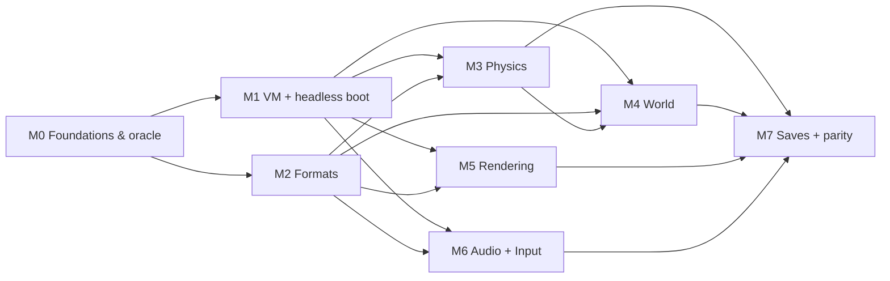

# Plan: full exact Rust replica of Street Legal Racing: Redline (stock v2.2.1, build 606)

Governing decisions: ADR 0004–0009. Vocabulary: `GLOSSARY.md`. Status of each function: the fidelity ledger in
`docs/fidelity.md`. **Complete** = every row of the parity checklist in `docs/fidelity.md` passes.

Ground rules for every issue:
- Runs on the developer's Apple Silicon Mac. No VMs, no Docker, no x86 machine (ADR 0008).
- The clean stock install is in `stock/`. Never modify `reference/` or `stock/`. Nothing derived from the
  original (assets, exe bytes, oracle vectors, traces) is committed.
- Ported functions carry their exe address annotation. An issue is done only when its acceptance test
  passes locally and the ledger regenerates with the new rows (a Jev gate is run before closing).
- Original bugs: confirm the bug in build 606, fix it in core, and record it as an intentional divergence (ADR 0007).
- Every acceptance claim names the oracle that ran (Unicorn function, macOS Wine trace, or headless original).

Labels: an issue whose blockers are all closed gets `ready-for-agent`; until then it is `needs-triage`.
Blockers use GitHub issue dependencies. Sizing: each issue fits one agent session (about one day).

## Facts this plan rests on (2026-10-17)

- Stock media extracts to 7,858 files (`msitools` + `cabextract`; sizes match the MSI File table; verified
  byte-identical to `msiextract`). No `.java` sources ship, so the script compiler is out of scope.
- The installer launches `StreetLegal_Redline.exe`, which matches `.bak.exe` (SHA-256 `7d77466a…2e8edde`,
  the reverse-engineering reference) except for one branch target inside the CD check (`FUN_00401480`).
- x87: CreateDevice uses flags 0x84 (fallback 0x24) without FPU_PRESERVE, and no game code changes precision,
  so game floats run at x87 PC=24, round-to-nearest. Game math is x87 only (VC6); SSE appears only in D3DX.
  RNG: MSVC `rand` (0x343FD/0x269EC3, per-thread state, 55 callers).
- Natives: 353 registrations (the old 338-row table had a regex bug); 216 are referenced by stock scripts.
  `java.io.Controller`'s 7 natives have no registration site in the decompiled code yet.
- Formats: all 2,921 SCX parse (390 v3 are undecoded); PTX, SDAT bodies, `.trc/.walk/.rest/.spl/.scm`,
  `.bon/.skl/.matrixdata` and the particle cfg dialect are undecoded. **The map geometry most likely lives
  inside the map RPK payloads** (RSD/EXTP/PHYS/POLY chunks; inferred): the 503 `area_*.scx` files those
  packages reference are not on disk.

## Milestones and issues

Format per issue: **id: title.** Crate. Acceptance. *Blocked by.*

### M0: Foundations and oracle

- **M0-01: Commit current work on `exact-port`.** Acceptance: branch pushed; `cargo test --workspace` green.
- **M0-02: Stock extraction script.** `tools/extract-stock.sh` (Homebrew `msitools` + `cabextract`, case-sensitive
  scratch volume, MSI Directory/Component/File path resolution) → `stock/`. Acceptance: 7,858 files, sizes equal
  File.FileSize, exe SHA-256 printed and checked against the expected list. *M0-01*
- **M0-03: Stock test profile.** Corpus tests default to `stock/` (`SLR_STOCK`) with stock counts (1,491 modules,
  5,262 bodies, 269,034 nodes, 94,703 pool entries, …); the modded counts become a compatibility profile on
  `reference/raw`. Acceptance: both profiles green. *M0-02*
- **M0-04: Native registration table, fixed.** Regenerate it with the `\)\s*;` fix and move the generator into `re/`.
  Acceptance: 353 rows including the 15 previously missing ones; Controller registration located or recorded as open. *M0-01*
- **M0-05: Crate restructure.** Split `slr-formats` into `slr-fmt-{rpak,scx,cfg,tufa,sdat}`; create empty
  `slr-fmt-{texture,sound}`, `slr-x87`, `slr-vm`, `slr-{lang,io,resource,physics,world,render-natives,sound}`,
  `slr-{d3d9,audio,input,platform,calllog,ledger}`. The old `slr-core`/`slr-game` are left untouched.
  Acceptance: the workspace builds and all tests pass. *M0-03*
- **M0-06: Ledger generator (`slr-ledger`).** Address annotation convention; it scans code plus a local test-results
  file and regenerates the ledger section of `docs/fidelity.md`. Acceptance: the ledger lists the existing format
  decoders with evidence links. *M0-05*
- **M0-07: x87 probe suite and SoftFloat reference.** Under `re/x87probe` (outside the workspace): fld/fst/fistp,
  fadd/fsub/fmul/fdiv/fsqrt, fsin/fcos/fpatan/f2xm1/fyl2x/fprem, compares, at PC 24/53/64 × all rounding modes,
  plus edge cases (denormals, exponent-range overflow of registers, double rounding). Runs on SoftFloat extF80
  and Unicorn. Acceptance: a trusted-operation table in `docs/x87.md` (no vectors committed). *M0-01*
- **M0-08: Unicorn function oracle.** A venv setup script, the game's control word per thread (24-bit on the
  device thread), the vector file format under `re/out`, and a runner keyed by exe address. Acceptance: one leaf
  float function round-trips vectors bit for bit. *M0-07*
- **M0-09: macOS Wine spike (time-boxed, 2 sessions).** Homebrew wine-stable first, then other macOS Wine
  builds. Run the stock exe to the main menu. Adds the Rosetta leg to the M0-07 probes (a probe exe run under
  Wine). Acceptance: main menu reached plus a probe table, or a failure report that unblocks M0-12. *M0-02, M0-07*
- **M0-10: Call-log format (`slr-calllog`).** One schema for native calls, D3D9, DirectSound, DirectInput, file
  I/O, VM state snapshots and per-frame vehicle state; a diff tool that reports the first divergence.
  Acceptance: round-trip tests; the diff tool's output is shown on a synthetic pair. *M0-05*
- **M0-11: Hook layer on the Wine-run exe.** Log every registered native (via the `FUN_00416b00` table), D3D9,
  DirectSound, DirectInput and file calls in the M0-10 format; inject deterministic replay (seed, fixed dt,
  scripted input). Acceptance: two identical replay runs produce identical logs from boot to the main menu.
  *M0-09 (success), M0-10*
- **M0-12: Headless original (conditional).** Only if M0-09 fails: the exe under Unicorn with logging
  Win32/D3D9/DSound/DInput stubs. Acceptance: same as M0-11. *M0-09 (failure), M0-08, M0-10*
- **M0-13: Platform seams (`slr-platform`).** `Clock`, `Rng` (exact per-thread MSVC `rand`), replay driver.
  Acceptance: `rand` sequence equals the Unicorn oracle for 10⁶ draws across several seeds. *M0-05, M0-08*
- **M0-14: X87 type (`slr-x87`).** An f80 value with precision control and rounding on SoftFloat; transcendentals
  pinned per `docs/x87.md`. Acceptance: matches every trusted probe. *M0-07*

### M1: VM and headless boot

- **M1-01: Complete the `Thread::run` semantics.** All 47 ops, the 0x1007 sub-ops, the open `!=`/`<=`/`<`
  negation, float NaN compares, and frame fields `+0x30/+0x34/+0x1c8`; finish `docs/tufa-executor.md`.
  Acceptance: Unicorn vectors per op handler. *M0-08*
- **M1-02: Values and objects.** Ref-counted values, strings, arrays, object layout and GC semantics as in the exe.
  Acceptance: per-helper differential tests (`FUN_0041bfb0` and its siblings). *M1-01*
- **M1-03: Interpreter loop.** Frames, calls, call-by-name (`FUN_004207c0`), callMethod (`FUN_0041fbc0`).
  Acceptance: per-op differential tests; synthetic scripts produce the same stack/value traces. *M1-02*
- **M1-04: Class loader and linker.** Package roots (`FUN_0040fe70`), resolution, dispatch, and a native
  registry keyed by exe address. Acceptance: every stock class loads and links; the registry reports 353 bindings.
  *M1-03, M0-04*
- **M1-05: Threads, timers, callbacks.** Thread, Object wait/notify, GameType timers and callbacks, with
  scheduling order exactly as in the exe. Acceptance: the scheduling trace equals the oracle on synthetic scripts. *M1-04*
- **M1-06 to M1-08: `slr-lang` natives** (split: Math/Float/Integer/String; Vector3/Ypr; Object/System/Class).
  Acceptance: per-native vectors. *M1-04, M0-14*
- **M1-09: `slr-io` natives.** File and FindFile (over `stock/`); Input, MouseCursor and Controller as logging
  stubs. Acceptance: per-native vectors. *M1-04*
- **M1-10, M1-11: `slr-resource` natives** (ResourceRef/GameRef; RenderRef/PhysicsRef/Animation/
  ParticleSystem/SfxRef as handles) over an RPAK resource manager. Acceptance: per-native vectors. *M1-04*
- **M1-12: Headless backends.** Render, sound and input natives write to the call log. *M0-10, M1-04*
- **M1-13: Headless boot acceptance.** The stock boot call log up to the main menu equals the oracle's.
  *M1-05..M1-12, M0-11 or M0-12*
- **M1-14: Delete the old approximate slice.** Remove `slr-core`/`slr-game`/macroquad in one commit; `slr-game`
  becomes the new host binary. *M1-13*

### M2: Remaining formats (runs in parallel with M1)

Each format issue's acceptance: every stock file of that format parses with zero leftover bytes; any exe loader
for it is ported and differential-tested; writers round-trip where the exe writes the format.
- **M2-01: SCX v3 and `.scy`.** *M0-05*
- **M2-02: PTX container (exe-ported) with JPEG decode.** *M0-05*
- **M2-03, M2-04: Map RPK binary payload** (RSD/EXTP/PHYS/POLY; split into survey+reader and geometry/physics
  chunks). *M0-05*
- **M2-05: SDAT bodies** (car saves `0x88664422`, options `0xFEDCBA98`) plus the JPEG companions. *M0-05*
- **M2-06: `.trc` traffic graph.** M2-07: `.walk`/`.rest`. M2-08: `.spl`, `.scm`. M2-09: `.bon/.skl/.matrixdata`.
  M2-10: particle cfg dialect. *M0-05*
- **M2-11: Standard media wrappers** (DDS/PNG/TGA via crates in `slr-fmt-texture`; WAV/MP3 in `slr-fmt-sound`).
  M2-12: Cinepak AVI decoder. *M0-05*

### M3: Physics

- **M3-01: Trace the physics loop.** Step and substeps, integrator, which thread runs it, and its control word.
  Write `docs/physics.md`. *M0-08*
- **M3-02: PhysicsRef and the rigid-body world.** M3-03, M3-04: WheelRef (35; tyre, suspension, contact patch).
  M3-05: Chassis (23). M3-06: Part (29) + Vehicle (3). M3-07: DynoData, SfxTable. M3-08: collision
  (`.scy` surfaces, GroundRef contact). M3-09: native cfg handlers (`enginepower` at 0x00443f90 and the rest).
  Acceptance (level 1): per-function differential tests, 0 ulp on trusted operations. *M3-01, M1-13, M0-14, M2-01*
- **M3-10: Scenario traces (level 2).** Drag, braking and collision for every stock car match the oracle
  per frame. *M3-02..M3-09, M0-11 or M0-12*

### M4: World

- **M4-01: GroundRef world and water.** M4-02: traffic (`.trc`, traffic cars). M4-03: pedestrians. M4-04:
  Navigator, GameLogic, police. M4-05: Painter and decals.
  Acceptance: per-native vectors plus scenario call logs. *M1-13, M2-03, M2-04, M2-06, M2-07*

### M5: Rendering

- **M5-01: D3D9 usage inventory** from the hook log: the states, stages, formats and draw paths the exe
  actually uses. *M0-11 or M0-12*
- **M5-02: `slr-d3d9` core.** Device, buffers, transforms, fixed-function lighting and material, texture stages
  translated to wgpu shaders. *M5-01*
- **M5-03: textures** (DXT, PTX, render targets). M5-04: GfxEngine/Viewport/Camera/Text natives. M5-05: SCX and
  skinned meshes. M5-06: particles. M5-07: OSD/frontend and fonts. M5-08: sky, fog, day/night. M5-09: video
  playback. M5-10: the macOS window, fullscreen, resolution and aspect.
  Acceptance: per-frame D3D9 call stream equals the oracle; perceptual screenshots for named scenes. *M5-02, M1-13*

### M6: Audio and input

- **M6-01: DirectSound emulation on CoreAudio** (3D included). M6-02: Sound, SfxRef and SfxTable natives, engine
  sound. M6-03: music. M6-04: input (keyboard, mouse, gamepad) with DirectInput semantics and ControlSet.
  Acceptance: the DirectSound and DirectInput call streams equal the oracle; listening check. *M1-13, M2-11, M0-11 or M0-12*

### M7: Saves and parity sweep

- **M7-01: SDAT writing natives.** Byte-identical saves; cross-load both ways. M7-02: options/config.
  *M2-05, M1-09*
- **M7-03: Original-bug confirmation and fixes.** Each Proofix item confirmed in build 606, then fixed as a
  ledgered divergence. *M1-13*
- **M7-04: CD-check replacement.** Checksum verification of `stock/`, ledgered. *M0-02*
- **M7-05..: One issue per parity-checklist row.** Plays the item end to end in deterministic replay against the
  oracle at its tier. *the milestones its row lists*

## Dependency graph (milestone level)

Parallel tracks once M0 lands: M1 (VM), M2 (formats, several sessions at once) and the M0-09/M0-11 oracle work.
After M1-13: M3, M5 and M6 run in parallel; M4 follows physics.

## Biggest risks

1. The stock exe may not run under macOS Wine (Jev ~0.54). Fallback is M0-12, which is costly.
2. No local implementation may honour x87 PC=24 bit-exactly. Triangulation (M0-07) may leave ops untrusted,
   which would weaken the C-tier claims for those ops. This must be reported, never hidden.
3. The map RPK payload is undocumented and large (32–38 MB). It blocks maps, physics collision and world.
4. Scale: 353 natives plus about 4,356 exe functions. The ledger is the honest progress measure.
